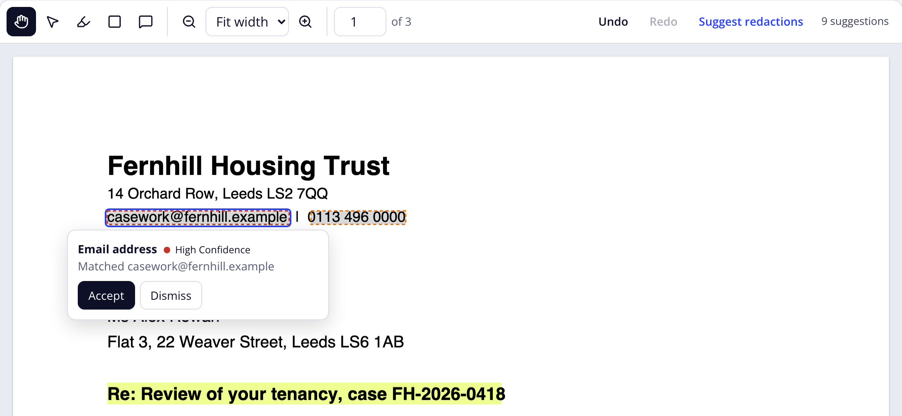

<p align="center">
  <picture>
    <source media="(prefers-color-scheme: dark)" srcset=".github/assets/inkbar-mark-on-dark.svg">
    
  </picture>
</p>

<h1 align="center">Inkbar</h1>

<p align="center">
  A full PDF editor for your web app. No licence fee.
</p>

<p align="center">
  <a href="https://inkbar.dev">Website</a> ·
  <a href="https://inkbar.dev/docs/">Docs</a> ·
  <a href="https://sandbox.inkbar.dev">Sandbox</a> ·
  <a href="https://www.npmjs.com/org/inkbar">npm</a>
</p>

---

Your users want to read a PDF, mark it up and send it back without leaving your app. The commercial PDF SDKs do that and charge per seat or per domain. PDF.js is free, but it renders pages and stops there: the toolbar, the annotations, undo and the keyboard support are yours to build.

Inkbar fills that gap. It renders, annotates and redacts PDFs in the browser, gives you the parts to build its UI in Vue, React, Svelte or plain TypeScript, and is free under the MIT licence.

<p align="center">
  
</p>

## Why Inkbar

- **Your framework.** Components and hooks for Vue 3, React 19 and Svelte 5, plus `createViewer` for apps with no framework at all. All four share one engine and one stylesheet.
- **Toolbars you assemble.** You build each toolbar in your own markup from Inkbar's controls: tool buttons, undo and redo, the zoom select, the page input. Keep the ones you need, place them where they fit and add your own. The theme styles them with zero-specificity rules, so your CSS wins without `!important`, and it reads shadcn token names if your app defines them.
- **Annotations as plain data.** Highlights, notes and redactions are typed objects. Keep them in your own state and save them to your own backend, or let Inkbar hold them. Undo and redo work either way.
- **Redaction with review.** Mark text or areas for redaction by hand, or pass in suggestions from your own detector. Each suggestion shows what it matched and how confident it is, and someone accepts or dismisses it before it counts.
- **Keyboard first.** Every tool works without a mouse: select text and press Enter to highlight it, move between annotations with the arrow keys, nudge them a point at a time.
- **Fits a real app.** Pass a signed URL and a stable key, and Inkbar won't reload the document when the URL rotates. You can import the document model during server rendering.

### What it does today

| Area        | Available now                                                                                                                                                  |
| ----------- | -------------------------------------------------------------------------------------------------------------------------------------------------------------- |
| Viewing     | Rendering, zoom, fit to width or page, page navigation, text selection                                                                                         |
| Markup      | Highlights from a text selection                                                                                                                               |
| Notes       | Notes with reply threads                                                                                                                                       |
| Redaction   | Text and area redaction marks, suggested redactions with confidence and review                                                                                 |
| Annotations | JSON import and export. Underline, strikeout, squiggly, ink, shapes and lines display from imported data and from the PDF's own annotations, which stay locked |
| History     | Undo and redo, with grouped steps, whether Inkbar or your app holds the annotations                                                                            |

### Coming soon

- **Forms.** Read and fill form fields in the viewer.
- **Search.** Find text across the document.
- **Drawing tools.** Draw freehand ink, shapes, lines and text boxes. Ink, shapes and lines already display from imported data.
- **Saving into the PDF.** Write annotations and applied redactions back into the file. Until then, store `exportAnnotations('json')` and load it on the next open.

## Install

Install the core, the theme and the package for your framework:

```sh
pnpm add @inkbar/react @inkbar/core @inkbar/theme
```

Swap `@inkbar/react` for `@inkbar/vue` or `@inkbar/svelte`. With no framework, `@inkbar/core` and `@inkbar/theme` are enough.

PDF.js loads a worker, fonts and decoders at runtime. With Vite, the plugin serves them:

```ts
// vite.config.ts
import { inkbar } from '@inkbar/core/vite'
import { defineConfig } from 'vite'

export default defineConfig({
  plugins: [inkbar()],
})
```

Without Vite, copy the files yourself and pass their URLs. The [`@inkbar/core` README](packages/core/README.md#serving-pdfjs-assets) lists them.

## Quick start

A complete viewer in React, with a toolbar above the pages, page and zoom controls below, note threads and suggestion cards:

```tsx
import {
  InkRoot,
  InkViewport,
  InkToolbar,
  InkToolButton,
  InkToolbarSeparator,
  InkUndo,
  InkRedo,
  InkPrevPage,
  InkPageInput,
  InkPageCount,
  InkNextPage,
  InkZoomSelect,
  InkNotePopover,
  InkSuggestionCard,
} from '@inkbar/react'
import { assets } from 'virtual:inkbar-assets'
import '@inkbar/theme/theme.css'

export function Review({ url }: { url: string }) {
  return (
    <div style={{ height: '100vh' }}>
      <InkRoot src={url} assets={assets}>
        <InkToolbar>
          <InkToolButton tool="select" />
          <InkToolButton tool="highlight" />
          <InkToolButton tool="redact-area" />
          <InkToolButton tool="note" />
          <InkToolbarSeparator />
          <InkUndo />
          <InkRedo />
        </InkToolbar>
        <InkViewport />
        <InkToolbar label="Page and zoom">
          <InkPrevPage />
          <InkPageInput />
          <InkPageCount />
          <InkNextPage />
          <InkZoomSelect />
        </InkToolbar>
        <InkNotePopover />
        <InkSuggestionCard />
      </InkRoot>
    </div>
  )
}
```

The viewer fills its parent, so give the parent a height. The same example for each framework, and how to keep annotations in your own state:

- [Vue](packages/vue/README.md)
- [React](packages/react/README.md)
- [Svelte](packages/svelte/README.md)
- [Plain TypeScript](packages/core/README.md#without-a-framework)

The [sandbox](https://sandbox.inkbar.dev) runs all four on a sample document. Drop in your own PDF to try it; the file stays in your browser.

## Packages

| Package                             | What it is                                                                      |
| ----------------------------------- | ------------------------------------------------------------------------------- |
| [`@inkbar/core`](packages/core)     | Document model, rendering, annotations and tools, with no framework dependency. |
| [`@inkbar/vue`](packages/vue)       | Vue 3 components and composables to build your viewer.                          |
| [`@inkbar/react`](packages/react)   | React 19 components and hooks to build your viewer.                             |
| [`@inkbar/svelte`](packages/svelte) | Svelte 5 components and hooks to build your viewer.                             |
| [`@inkbar/theme`](packages/theme)   | The default stylesheet. Zero specificity, compatible with shadcn token names.   |
| [`@inkbar/icons`](packages/icons)   | The icons the toolbar controls show, as data, with their licence notices.       |

The six packages are released together and share one version number. The framework packages take `@inkbar/core` as a peer dependency, so your app installs one copy of it.

## Development

You need Git, Node 24 and pnpm. The repository pins its pnpm version in `package.json`, so `corepack enable` picks the right one. The test fixtures are generated with [qpdf](https://qpdf.sourceforge.io/), and the browser tests run in Playwright's Chromium.

### Check out and build

```sh
git clone https://github.com/inkbar/inkbar.git
cd inkbar
pnpm install
pnpm build
```

### Run locally

```sh
pnpm --filter @inkbar/sandbox dev     # the sandbox on http://localhost:5190
pnpm --filter @inkbar/e2e-vue dev     # the Vue review app on http://localhost:5180
pnpm --filter @inkbar/e2e-react dev   # the React review app on http://localhost:5181
pnpm --filter @inkbar/e2e-svelte dev  # the Svelte review app on http://localhost:5182
```

The sandbox is the public demo. The review apps load every fixture and back the end-to-end, accessibility and performance tests.

### Test

```sh
pnpm lint
pnpm typecheck
pnpm test                                                # unit tests
pnpm --filter @inkbar/core exec playwright install chromium
pnpm test:browser                                        # component and end-to-end tests
```

`pnpm format` runs Prettier over the repository, and `pnpm format:check` is what CI runs.

### Layout

| Path              | Contents                                                                   |
| ----------------- | -------------------------------------------------------------------------- |
| `packages/core`   | `@inkbar/core`: the document model, the DOM layer and the Vite plugin      |
| `packages/vue`    | `@inkbar/vue`                                                              |
| `packages/react`  | `@inkbar/react`                                                            |
| `packages/svelte` | `@inkbar/svelte`                                                           |
| `packages/theme`  | `@inkbar/theme`                                                            |
| `apps/sandbox`    | The sandbox at sandbox.inkbar.dev                                          |
| `apps/e2e-*`      | The review apps for each framework and the end-to-end suite they share     |
| `fixtures`        | Test PDFs, the script that generates them, and helpers for the test suites |

PDF.js is imported only under `packages/core/src/pdfjs/`. Every coordinate is in PDF user space: points, origin bottom-left, before `/Rotate`. Only `packages/core/src/dom/transform.ts` converts to CSS pixels.

### Contributing

Open a pull request against `main`. Pull requests are squash merged and the title becomes the commit message, so write it as a [Conventional Commit](https://www.conventionalcommits.org/) such as `feat(vue): expose the page count` or `fix(core): keep the selection after a zoom`. Commits carry the title only, with no body. [release-please](https://github.com/googleapis/release-please) cuts each release from those titles.

## Licence

[MIT](LICENSE). From the team behind [Redactr](https://redactr.io).
